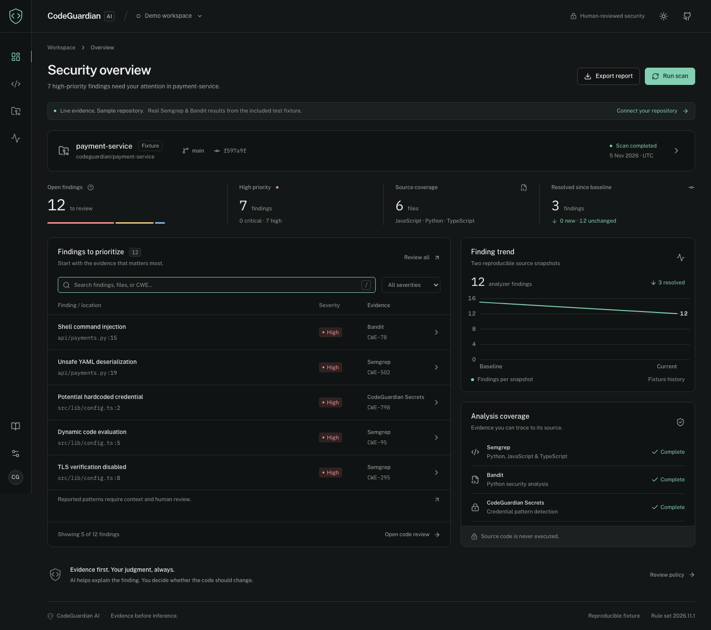
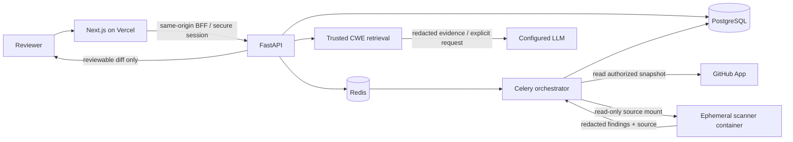

<div align="center">


# CodeGuardian AI

**Evidence before inference.**

An intelligent secure code review workspace built around real static analysis,
redacted source snapshots, and human-reviewed fixes.

[Getting started](#getting-started) · [Architecture](docs/architecture.md) · [Deployment](docs/deployment.md) · [Security model](SECURITY.md) · [API](docs/api.md)

</div>

<!-- Screenshot is captured from the working application, with synthetic fixture data only. -->


## What works

- **Authorized import:** GitHub App OAuth, selected-repository access checks, or an explicitly authorized source ZIP.
- **Real analysis:** Semgrep rules for Python, JavaScript and TypeScript; Bandit for Python; credential pattern detection with redaction.
- **Traceable evidence:** engine, rule, confidence, CWE/OWASP category, source location, and line-level Monaco review.
- **Grounded explanations:** local retrieval from curated CWE guidance; optional OpenAI-compatible LLM with a strict output schema and citation validation.
- **Reviewable suggestions:** bounded rule-based patches, side-by-side diffs, and a required review acknowledgment before patch export.
- **Review workflow:** confirm, dismiss with a reason, reopen, and record audit events.
- **Commit comparison:** new, resolved and unchanged findings using stable fingerprints; partial scans cannot establish a reliable baseline.
- **Reporting:** JSON, Markdown and SARIF exports, repository summaries, and trends from actual scan history.
- **Optional PR checks:** signed GitHub webhooks can enqueue scans and publish check annotations for same-repository pull requests.
- **Developer interface:** dark/light themes, responsive layouts, self-hosted Monaco and fonts, restrained glass surfaces, keyboard focus and search.

The bundled demonstration is generated by **real scanner runs**, not hand-authored findings: 12 current findings, 15 baseline findings, 3 resolved. Counts are reproducible against the pinned analyzer versions. Snapshot hashes in the demonstration are content hashes, not Git commits.

## Evidence model

| Label | Meaning |
|---|---|
| Analyzer evidence | A configured static analyzer reported this pattern. It does **not** verify exploitation or reachability. |
| Potential vulnerability | A heuristic needs contextual verification; suspected credentials are never assumed active. |
| Secure-coding suggestion | A proposed improvement, explicitly untested and subject to human review. |

AI cannot change these labels. It cannot execute tools, modify source, create branches, open PRs, or merge code. Patches are currently curated rule templates; AI supplies explanations, not executable actions. Export a reviewed patch, test it locally, then open a PR using your normal workflow.

## Stack

| Layer | Implementation |
|---|---|
| Web | Next.js 16, React 19, TypeScript, Tailwind CSS 4, Monaco |
| API | Python 3.12, FastAPI, SQLModel, Alembic |
| Persistence | PostgreSQL; SQLite only for local development and tests |
| Jobs | Redis + Celery, bounded per-scan Docker containers |
| Analysis | Pinned Semgrep, Bandit, application-owned rule pack |
| AI | Configurable OpenAI-compatible API + local CWE retrieval |
| Hosting | Vercel frontend; dedicated container host for API/workers/database |

## Getting started

Requires Node.js 22+, pnpm 11.25.0 and Python 3.12. Docker is required to analyze **any untrusted repository**.

```bash
git clone https://github.com/aashleshshet/CodeGuardian.git
cd CodeGuardian
corepack enable
corepack prepare pnpm@11.25.0 --activate
pnpm install --frozen-lockfile
python3.12 -m venv .venv
.venv/bin/pip install -r backend/requirements.txt
```

### Explore the review interface

```bash
pnpm dev
```

Open [localhost:3000](http://localhost:3000). This works with the checked-in, redacted fixture evidence and needs no credentials. Filters, source inspection, patch review, session-only triage, reports and themes work. Import and new scan actions explain that a backend is needed; they never simulate successful scans.

### Run the complete local fixture flow

In one terminal:

```bash
export PATH="$PWD/.venv/bin:$PATH"
ALLOW_DEMO_LOGIN=true TASKS_EAGER=true SCANNER_MODE=trusted-fixture \
  .venv/bin/uvicorn app.main:app --app-dir backend --host 127.0.0.1 --port 8000 --no-access-log
```

In another:

```bash
API_URL=http://127.0.0.1:8000 pnpm dev
```

Click **Run scan**. The development-only session queues an eager task, runs the actual analyzers against the exact bundled fixture, persists the redacted snapshot and findings in SQLite, and renders the result. Confirm a finding and reload it from Repositories to verify persistence.

`trusted-fixture` is a deliberately narrow development path: it compares the entire input to the application-owned fixture bytes and refuses all other source. Production refuses this mode and demo login.

### Scan authorized repositories

Follow [container deployment](docs/deployment.md). Configure your GitHub App, or upload an authorized ZIP through an authenticated session. Untrusted inputs always require the container runner. No `npm install`, Python import, build hook, repository config, or repository test suite is executed.

## Tests and reproducibility

```bash
export PATH="$PWD/.venv/bin:$PATH"
pytest backend/tests -q
pnpm typecheck
pnpm build
pnpm exec playwright install chromium
pnpm test:e2e
python scripts/build_demo.py
```

Backend tests cover traversal, symlinks, duplicate paths, archive expansion limits, secret redaction, tenant isolation, authentication, CSRF, webhook forgery, patch review gates, retrieval grounding, and actual scanner integration. Playwright checks review and export interactions, themes/mobile layout, and the browser → API → scanner → database → review flow. CI also builds and runs the isolated scanner image.

The fixture is intentionally unsafe. **Never run it as an application.** See [fixtures/README.md](fixtures/README.md).

## Architecture



See [architecture and trust boundaries](docs/architecture.md) for the isolation model, data lifecycle and limits.

## MVP boundaries

This is a functioning MVP, not a claim of enterprise security certification. Static rules are intentionally bounded; they cannot establish full program behavior. Secret detection is best effort and may miss unknown formats. Findings from different analyzers remain separate evidence, and identical repeated matches within a file are collapsed by fingerprint.

Live GitHub imports/checks and external LLM calls require your credentials and service configuration. The Vercel frontend alone is a fixture explorer until `API_URL` points to a deployed backend. Direct PR creation, automatic fix application, dependency/SCA scanning, cross-file taint analysis, organization roles, token refresh, advanced retention controls and enterprise SSO are not implemented. Optional checks skip fork pull requests. These limitations are visible in the interface and documented in the [security model](SECURITY.md).

## Repository layout

```text
app/                   Next.js app and server-only API proxy
components/            Review console, source/diff viewer, charts
backend/app/           API, auth, import, normalization, AI, queue, isolation
backend/rules/         Trusted Semgrep rules
backend/knowledge/     Trusted CWE retrieval corpus
backend/migrations/    Versioned PostgreSQL schema
backend/tests/         Security and real-scanner integration tests
fixtures/              Baseline and current intentionally vulnerable snapshots
scripts/               Reproducibility, isolated CLI scan, maintenance
tests/e2e/             Browser and full-stack tests
docs/                  Architecture, deployment, API, verification
```

## Development and contributions

Run the checks above before proposing changes. Keep source-derived strings out of logs, treat new analyzer integrations as untrusted parsers, and add a malicious-input regression test when changing a trust boundary. Do not replace failed scans with empty successful results. See [SECURITY.md](SECURITY.md) for vulnerability reporting.

Third-party packages keep their own licenses. The chart helper is attributed in [THIRD_PARTY_NOTICES.md](THIRD_PARTY_NOTICES.md).
