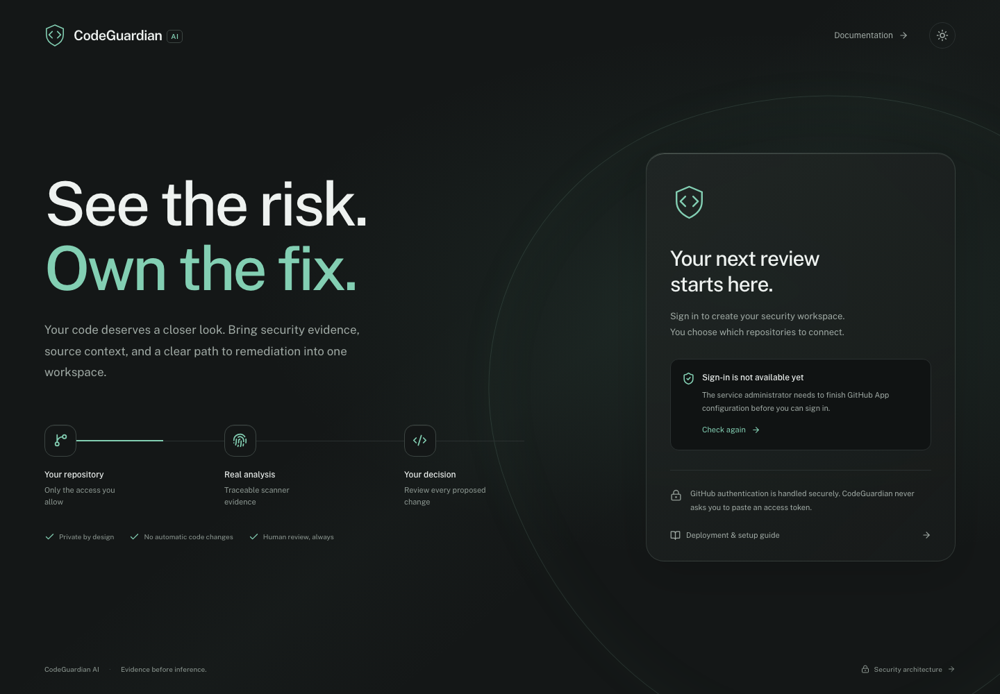
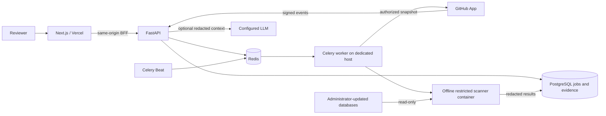

# CodeGuardian AI

**Security evidence, source context, and reviewed remediation in one workspace.**

CodeGuardian analyzes authorized Python, JavaScript, and TypeScript repositories with real security tools. It keeps analyzer evidence separate from potential vulnerabilities and optional AI guidance. Suggested changes remain reviewable, untested patches that a human must approve before exporting.

[Website](https://codeguardian-ai-rho.vercel.app) · [Deployment](docs/deployment.md) · [Architecture](docs/architecture.md) · [Security model](SECURITY.md) · [Verification](docs/verification.md)



> **Deployment status:** the Vercel frontend is independently deployable. A container host and GitHub App credentials are required to activate sign-in and repository scanning. An unconfigured deployment shows a setup notice. There is no production demo account, fixture workspace, or fabricated activity.

## What works

- GitHub App OAuth with PKCE and one-use state, encrypted rotating access/refresh tokens, opaque sessions, CSRF and tenant authorization.
- Selected public/private repository access; multiple installations; metadata synchronization; branch and commit selection; disconnect/revocation handling.
- Authorized ZIP uploads, bounded archive extraction, durable PostgreSQL scan jobs, Redis/Celery dispatch, actual stage progress, cancellation, bounded manual retries, and worker heartbeat recovery.
- **Semgrep, Bandit, Gitleaks, OSV-Scanner and Trivy** process integrations. OSV and Trivy consume administrator-provisioned offline databases. Scanner subprocesses run in network-disabled Docker containers with CPU, memory, process, file-size and wall-clock limits.
- Normalized findings, stable fingerprints, relevant CWE/OWASP mappings, secret redaction, dependency/advisory references, durable first/last seen and triage history.
- Monaco source review and side-by-side patch diffs; severity, scanner, status, filename and first-seen filtering; grounded explanations; human acknowledgement before patch export.
- Optional local Ollama/OpenAI-compatible generation with retrieved trusted guidance, strict output schema and grounded advisory identifiers. Static analysis works without an LLM.
- Signed/idempotent GitHub webhooks, opt-in push and same-repository PR scans, scheduled scans, optional GitHub check summaries and an explicit blocking policy.
- Persisted dashboard counts, scan history, commit comparison, notifications, JSON/SARIF/Markdown reports, data deletion and retention maintenance.
- Obsidian/sage interface, liquid-glass navigation and onboarding, purposeful motion, dark/light themes, reduced-motion support and responsive layouts.

## Evidence contract

| Class | Meaning |
| --- | --- |
| Analyzer evidence | A tool reported a specific pattern or advisory match. This does **not** prove exploitability. |
| Potential vulnerability | A heuristic, such as a credential pattern, requires contextual verification. |
| Secure-coding suggestion | A proposed improvement, separate from a scanner finding. Patches are not automatically tested or applied. |

Missing analyzers, stale vulnerability data and parsing errors yield **incomplete coverage**, never a clean result. Dependency versions matching an advisory do not prove reachability. Unmapped weaknesses remain explicitly unmapped.

## Stack

Next.js / TypeScript / Tailwind CSS / Monaco · FastAPI / SQLModel / Alembic · PostgreSQL · Redis / Celery · GitHub App · optional local or explicitly enabled remote LLM.

## Run the frontend

```sh
corepack enable
pnpm install --frozen-lockfile
pnpm dev
```

Open `http://127.0.0.1:3000`. Without `API_URL`, the landing page explains that service setup is pending. For actual sign-in and imports, follow the [Docker deployment guide](docs/deployment.md).

## Run the test suite

Requires Python 3.12, Node 22+ and pnpm 11.25.0.

```sh
python3.12 -m venv .venv
.venv/bin/pip install -r backend/requirements.txt
export PATH="$PWD/.venv/bin:$PWD/.cache/tools:$PATH"
python scripts/install_scanners.py --destination .cache/tools
python scripts/update_scanner_data.py --cache-dir .cache/scanner-data
RUN_ALL_SCANNERS=true SCANNER_CACHE="$PWD/.cache/scanner-data" pytest backend/tests -q
pnpm typecheck
pnpm build
pnpm exec playwright install chromium
pnpm test:e2e
```

The binaries are version-pinned and checksum-verified. The offline database download is approximately hundreds of megabytes and changes over time; record its manifest when reproducing findings. To run the faster Python/security suite without additional binaries, omit `RUN_ALL_SCANNERS`; the five-tool integration test explicitly skips.

Browser tests use `backend/tests/e2e_app.py`, an isolated test-only authentication harness that refuses non-test environments. Production container images exclude that package. The harness invokes real Semgrep/Bandit processes on exact application-owned fixture bytes and persists their results. It is not a production login route.

The intentionally vulnerable fixtures are **test inputs only**. Never run or deploy them. See [fixtures/README.md](fixtures/README.md).

## Architecture



The API has no Docker socket. The worker's Docker authority belongs on a dedicated host and is not a shared application-host security boundary. Use a dedicated rootless daemon where feasible and validate its mount/UID configuration.

## Deployment and migration

The complete setup, environment variables, GitHub permissions, cache update commands, backups, readiness checks and smoke tests are in [docs/deployment.md](docs/deployment.md). Revision `002` adds installations, durable jobs, finding history, AI analysis records, preferences, notifications and worker health; it preserves imported evidence, removes explicitly marked legacy fixture rows, and purges legacy retained source. It is forward-only: back up before upgrading.

## Known boundaries

This is a functioning MVP with production-oriented safeguards, not a claim of independently audited enterprise readiness. Live GitHub App/private-repository and LLM behavior must be validated with the operator’s credentials. No backend host was selected for this release.

Direct repository writes, automatic merging and in-app PR creation are disabled. Export a reviewed patch, test it locally and create a PR yourself. Fork PRs are skipped. The bundled rules do not cover every vulnerability or language framework. Trivy scans source/manifests/configuration; CodeGuardian does not build or execute submitted container images. UI lists expose the latest 100 repositories, 20 scans per repository and bounded branch/commit pages; API pagination supports further retrieval. Trend points are per-scan counts, not an aggregate security score.

Optional advisory enrichment is bounded and best-effort. Secret detection cannot guarantee discovery of unknown, encoded or split credentials. Latest finding state is retained until repository/account deletion; historical scan retention does not erase the latest evidence. Source normally expires after 24 hours. See [SECURITY.md](SECURITY.md) for the complete boundaries.

## Source map

```text
app/                    Next.js routes and same-origin API proxy
components/             Connected workspace, landing, source/diff viewer
backend/app/            API, authorization, jobs, adapters, AI, lifecycle
backend/migrations/     Alembic revisions
backend/rules/          Application-owned analyzer configurations
backend/knowledge/      Trusted retrieval guidance
backend/tests/          API/security/scanner/migration tests and E2E harness
fixtures/               Reproducible vulnerable test inputs
scripts/                Binary/cache provisioning, isolated scanning, maintenance
docs/                   Deployment, architecture, API and verification
```

Licensed under [MIT](LICENSE). Third-party analyzers retain their respective licenses.
