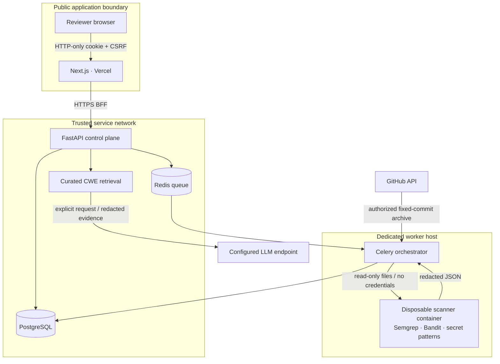
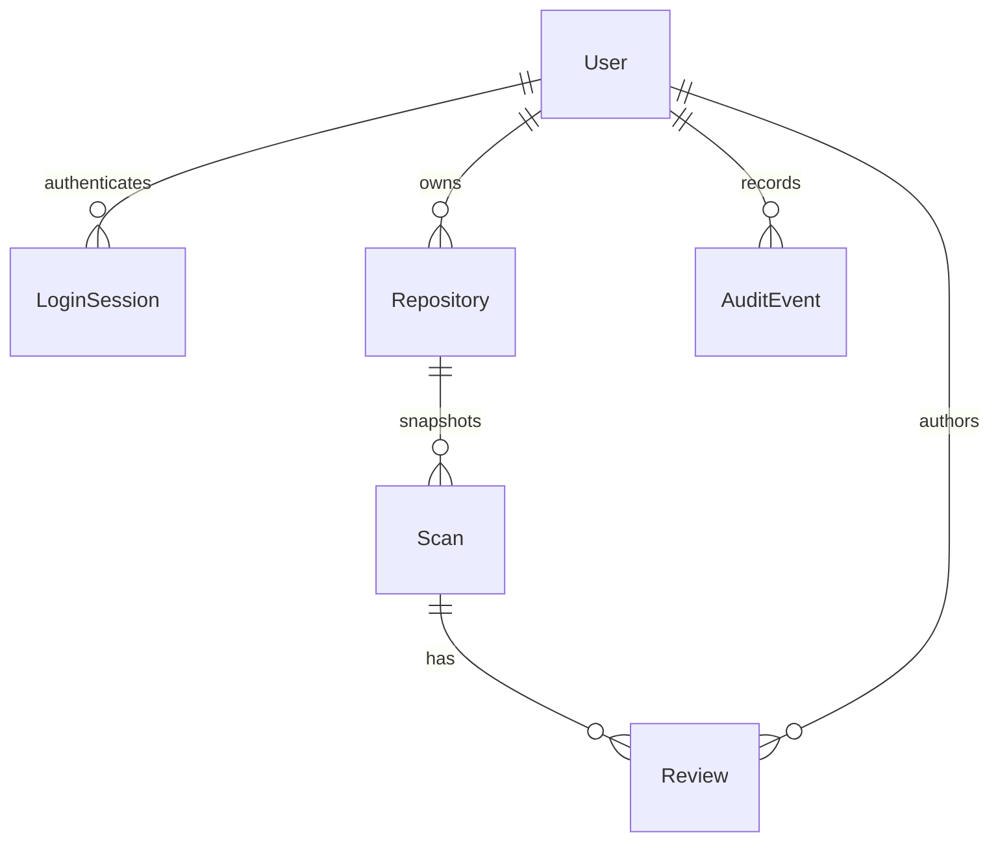

# Architecture

CodeGuardian keeps the trusted control plane separate from parsers that consume repository content.



## Scan sequence

```mermaid
sequenceDiagram
  actor Reviewer
  participant Web as Next.js BFF
  participant API as FastAPI
  participant Queue as Redis/Celery
  participant Runner as Dedicated orchestrator
  participant Scan as Isolated scanner
  participant DB as PostgreSQL
  Reviewer->>Web: Import authorized repository
  Web->>API: Session + CSRF + repository ID
  API->>API: Verify ownership and GitHub access
  API->>DB: Create queued scan + audit event
  API->>Queue: Enqueue scan ID
  Queue->>Runner: Deliver scan
  Runner->>Runner: Recheck authorization; download fixed SHA
  Runner->>Runner: Validate archive and source limits
  Runner->>Scan: Read-only snapshot, trusted rules
  Scan->>Scan: Run analyzers; normalize; redact
  Scan-->>Runner: Redacted findings, source and coverage
  Runner->>DB: Persist immutable result
  Web->>API: Poll scan status
  API-->>Reviewer: Evidence, source and grounded guidance
  Reviewer->>API: Request a proposed patch
  API-->>Reviewer: Untested diff with caveat and digest
  Reviewer->>API: Acknowledge review + matching digest
  API-->>Reviewer: Download patch; no repository write
```

## Data model



Scan findings and redacted files are JSON columns in the MVP. This makes an exact snapshot easy to inspect and reproduce; larger deployments should move redacted source to encrypted object storage and normalize findings into indexed tables. SQLModel supports PostgreSQL, and Alembic migrations own production schema changes. Development SQLite is not a production substitute.

## Evidence and identity

- Fingerprint = SHA-256 of analyzer, rule, path and whitespace-normalized, redacted matched line; truncated to 24 hexadecimal characters. Moving a line without changing the matched statement preserves identity. Renaming a file or changing the statement intentionally creates a different finding. Repeated identical statements in one file collapse.
- Confidence is the analyzer's confidence, not a model probability. Severity is normalized from analyzer levels. Different analyzers may report the same weakness separately.
- Verified analyzer evidence means the analyzer reported a pattern. Potential credentials remain potential vulnerabilities. Suggestions are never promoted to analyzer evidence.
- Scanner failures are recorded as partial/failed results. Comparisons advertise reliability only when both snapshots have complete configured coverage.
- OWASP mappings are explicitly the **2021 taxonomy**, identified in each finding. Unknown mappings are left unmapped rather than invented.

## Resource envelope

| Boundary | Limit |
|---|---|
| Browser BFF upload | 4 MB |
| API ZIP | 10 MB compressed / 20 MB expanded |
| Intake | 500 selected files, 250 KB per file, 5,000 total ZIP entries |
| Analyzer output | 8 MB |
| Container | 1 CPU, 1.5 GiB RAM, 64 PIDs, 256 open files |
| Writable container space | 128 MB noexec/nosuid tmpfs |
| Analyzer time | 120 seconds each; 180-second whole container limit |
| Celery task | 225-second soft / 240-second hard limit |
| Active scans | 3 per owner (best-effort admission limit) |
| Authenticated mutations | 30/minute in production |
| LLM explanations | 5/minute per user in production |

Three-scan admission is not a strict distributed reservation; concurrent requests may briefly overshoot. Worker concurrency, per-container limits and ingress controls remain the resource boundary. Shared SQLite/eager development is intended only for the trusted fixture.

## Raw data lifecycle

GitHub archives are downloaded with bounded streaming. ZIP source is selected in memory, then written to a private temporary job directory accessible to the scanner mount. Uploaded source is Fernet encrypted before broker transport. Raw analyzer output stays in private temporary files and is never logged. Container results are redacted before persistence. Finally blocks remove containers and staging directories on normal failures/timeouts; host-level cleanup is still needed after hard process kills or machine failure.

## Deployment split

Vercel runs the Next.js frontend and same-origin BFF. It does not run Docker or Celery. A dedicated Linux container host runs the API, database, Redis and trusted orchestrator. Untrusted scans run in separate ephemeral containers. Docker socket access exists only in the orchestrator, on a dedicated host. For hostile multi-tenant SaaS, evaluate stronger isolation and an external security review before accepting arbitrary customer code at scale.
