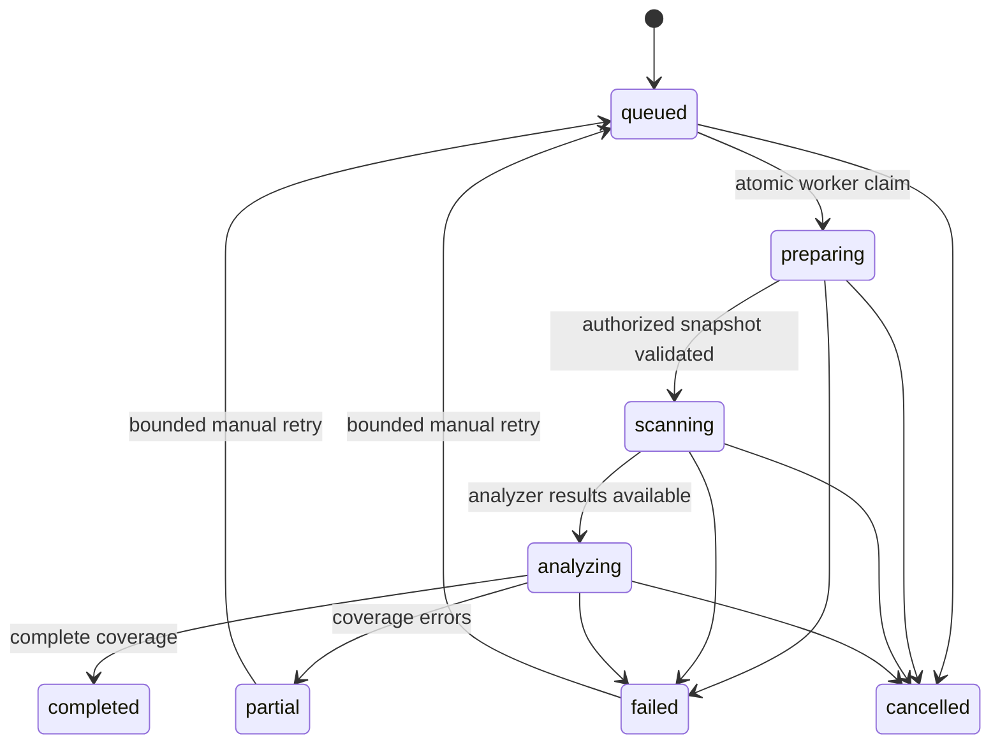

# Architecture and trust boundaries

```mermaid
sequenceDiagram
    participant Browser
    participant BFF as Next.js BFF
    participant API as FastAPI
    participant DB as PostgreSQL
    participant Broker as Redis
    participant Worker as Dedicated Celery worker
    participant GitHub
    participant Sandbox as Offline scanner container
    Browser->>BFF: Session + CSRF + selected commit
    BFF->>API: Fixed upstream, bounded request
    API->>GitHub: Verify user/installation/repository access
    API->>DB: Lock user; commit queued job and audit event
    API->>Broker: Opaque scan ID
    Broker->>Worker: Deliver job (at least once)
    Worker->>DB: Atomically claim queued job
    Worker->>GitHub: Scoped token; authorized snapshot
    Worker->>Sandbox: Bounded source mount, read-only database cache
    Sandbox-->>Worker: Normalized, redacted findings and coverage
    Worker->>DB: Persist findings and lifecycle; clear upload source
    Browser->>API: Poll actual job state
    API-->>Browser: Tenant-scoped evidence and retained source
```

GitHub OAuth uses PKCE and one-use expiring state. Access and refresh tokens are Fernet-encrypted. Browser sessions use hashed opaque IDs and HTTP-only, Secure-in-production, SameSite=Lax cookies. Authenticated mutations check the exact frontend Origin and CSRF token. Repository APIs revalidate GitHub authorization; no arbitrary clone URL is accepted.

Repository snapshots are read as bounded ZIP data. Paths, links, count, individual/total size and compression are validated. Source is not imported into Python or executed by Node. Configurations, rules and scanner binaries belong to the application. Submitted analyzer configuration and suppression comments cannot replace application policy.

Workers run five analyzers within a dedicated no-network, read-only container with dropped capabilities, no-new-privileges, non-root user, constrained tmpfs, CPU/memory/PID/file limits and wall-clock deadline. The API has no Docker access. The worker daemon boundary requires a dedicated host; it is not a microVM or a proof against kernel vulnerabilities.

The broker carries job IDs only. Encrypted upload source lives temporarily in PostgreSQL. A queued row is an outbox entry when broker delivery fails. Worker claims are atomic; heartbeat/cancellation and final row checks prevent cancelled/deleted jobs being resurrected. Beat redispatches pending jobs and marks stale workers failed. Retries are bounded and explicit. PostgreSQL user row locks serialize admission; SQLite is only used in tests/local development.



Finding identity combines category, rule/advisory, path and normalized evidence (or package/version). Duplicate dependency evidence can record multiple scanner sources. Durable findings are scoped by repository and branch, preserving review status, first/last seen and resolution. Only complete subsequent coverage resolves an absent finding. Partial scans never imply resolution. PR comparison inspects the base and head in isolated runs; changed files are informational and bounded to GitHub's response limits.

Optional AI retrieves trusted local guidance by weakness and lexical relevance. Source/analyzer context is explicitly untrusted, redacted and bounded. The model has no tools; strict JSON schema and allowed advisory/citation identifiers constrain output. Model prose still needs human review. Patches use bounded curated rule templates, never automatic application or merging.

Reports exclude source files and credentials. Source expires separately from historical results. Account/repository deletion removes dependent data; latest finding state is deliberately retained by historical cleanup until explicit deletion. Signed webhook delivery IDs and job keys provide idempotence. Fork PR scanning, direct PR creation, enterprise tenancy roles and unlimited repository scale are outside this MVP.
