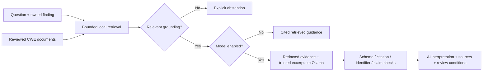

# Finding-scoped RAG security agent

The local `/workspace` review screen includes a **Security agent** for questions about the selected scanner finding. It retrieves application-owned security guidance, optionally asks the configured model to interpret it alongside bounded evidence, and validates the response before returning it with citations. No repository connection is required; authorized ZIP scans work.

On the on-device stack, generation uses the installed Qwen2.5-Coder model through Ollama. On Vercel, the public code checker remains browser-only. Model-backed RAG requires the local review service or an explicitly configured backend; Vercel does not gain access to your Mac or model.

## Use

1. Open `http://localhost:3000/workspace`, sign in with the local access key, and open a completed scan.
2. Select a finding in **Code review** and open its **Security agent** panel.
3. Ask a question or use an evidence, remediation or test prompt. **Use local model** enables generation; switch it off for retrieved guidance only.
4. Expand **Sources used** to inspect the actual excerpts and their MITRE references. Verify the answer against application context.

Only the last three question/answer pairs are displayed, in component memory. Every question is independently scoped to the current finding; the agent does not infer previous conversational references. Selecting another finding or leaving the page clears the conversation. Neither questions nor answers are saved to reports or database records. An audit event records the finding identity only. Cancel stops waiting in the browser; an already-running upstream model request may finish within its timeout.

## Retrieval and generation



The corpus is in `backend/knowledge/guidance.json` and `agent-guidance.json`. The index uses BM25 lexical scores, analyzer CWE priority and topic anchors. It returns at most three documents. This is retrieval-augmented generation over a small reviewed corpus, not an embedding search service or whole-repository reasoning engine. Corpus changes are code-reviewed and versioned with the application; repository comments and documentation cannot add trusted documents.

The endpoint is `POST /scans/{scan_id}/findings/{fingerprint}/agent` with `question` (3–3000 characters) and `use_model` (default false). Existing session, origin/CSRF and ownership checks apply. Generation shares the per-user LLM limit; retrieval has its own bounded request limit. The server obtains the finding and source from the owned scan, never from client-supplied evidence.

The model sees at most a 2400-character source excerpt around the finding, bounded metadata, a redacted question, and retrieved guidance. The whole question/source payload is untrusted. It has no tools, repository-write authority, web access or execution capability. Citations must match retrieved IDs; URLs and excerpts come from the server, not model output. The original evidence classification is preserved. Schema and claim guards reject some observable unsupported assertions, but cannot establish semantic correctness. All model output remains an interpretation requiring review.

Invalid, oversized, failed or unsupported model answers produce an error that offers retrieved guidance as the recovery path. Unknown weaknesses and off-topic questions abstain rather than force unrelated guidance. Secret masking is best effort; novel secret formats can be missed. Never use a generated answer as a security clearance.

## Verification

```sh
pytest backend/tests/test_rag_agent.py backend/tests/test_local_ai.py backend/tests/test_api.py -q
pnpm test:e2e
python scripts/local_setup.py smoke
```

Unit tests cover ranked retrieval, unknown-topic abstention, prompt-boundary/redaction contracts, citation validation, unsupported claims and model failure. Browser tests exercise questions, source expansion and finding changes. The local smoke test uses the owned vulnerable fixture, real isolated scanners and the configured local model, then removes its temporary repository.
